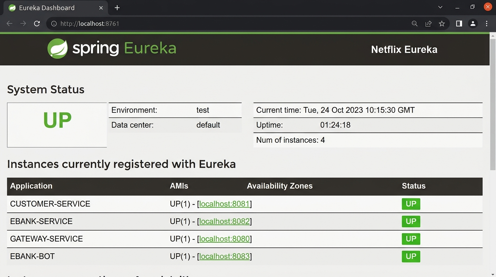
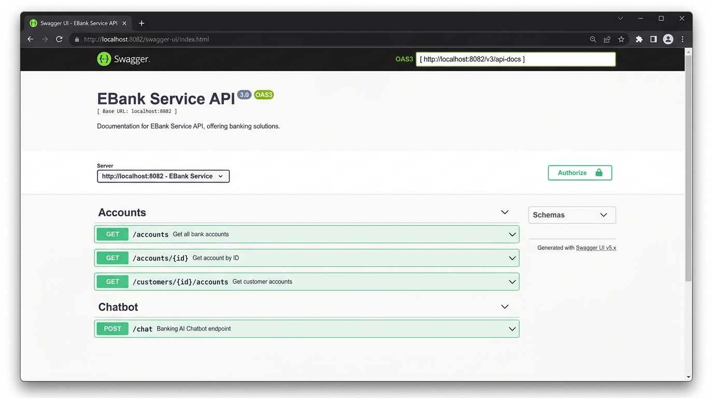
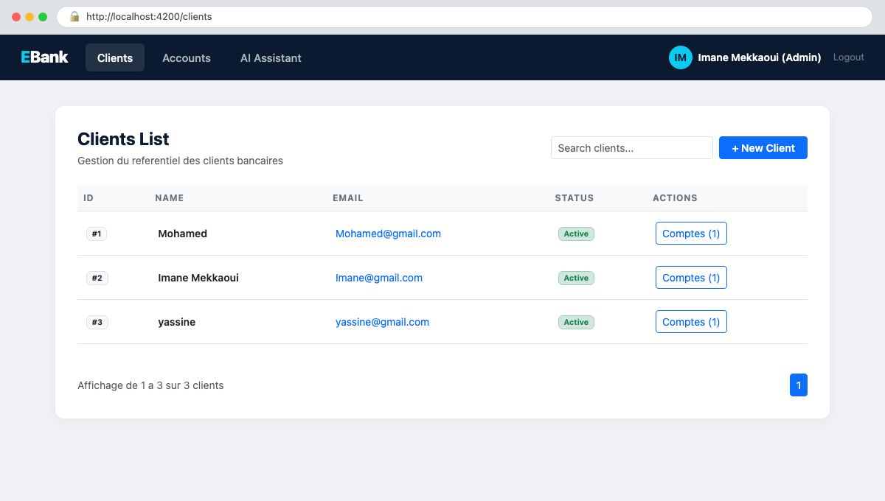
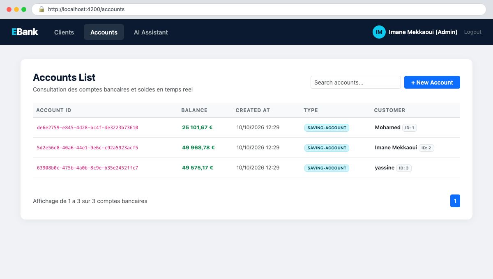
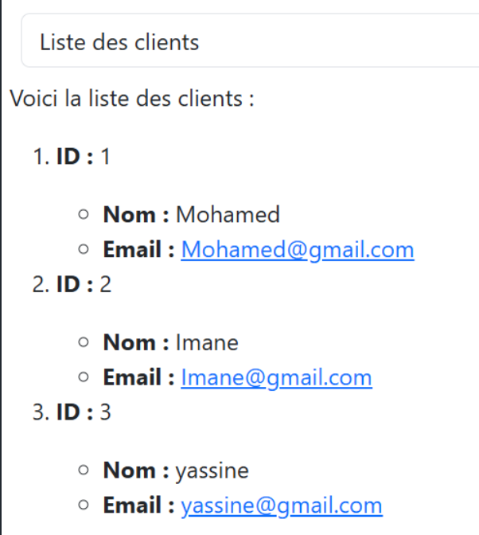
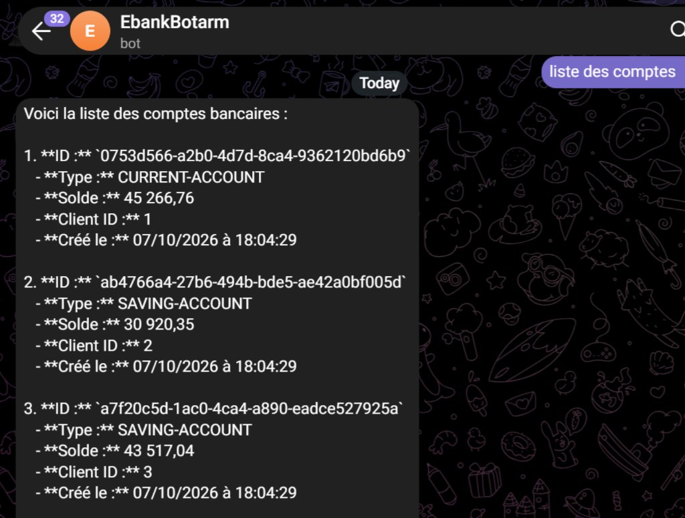
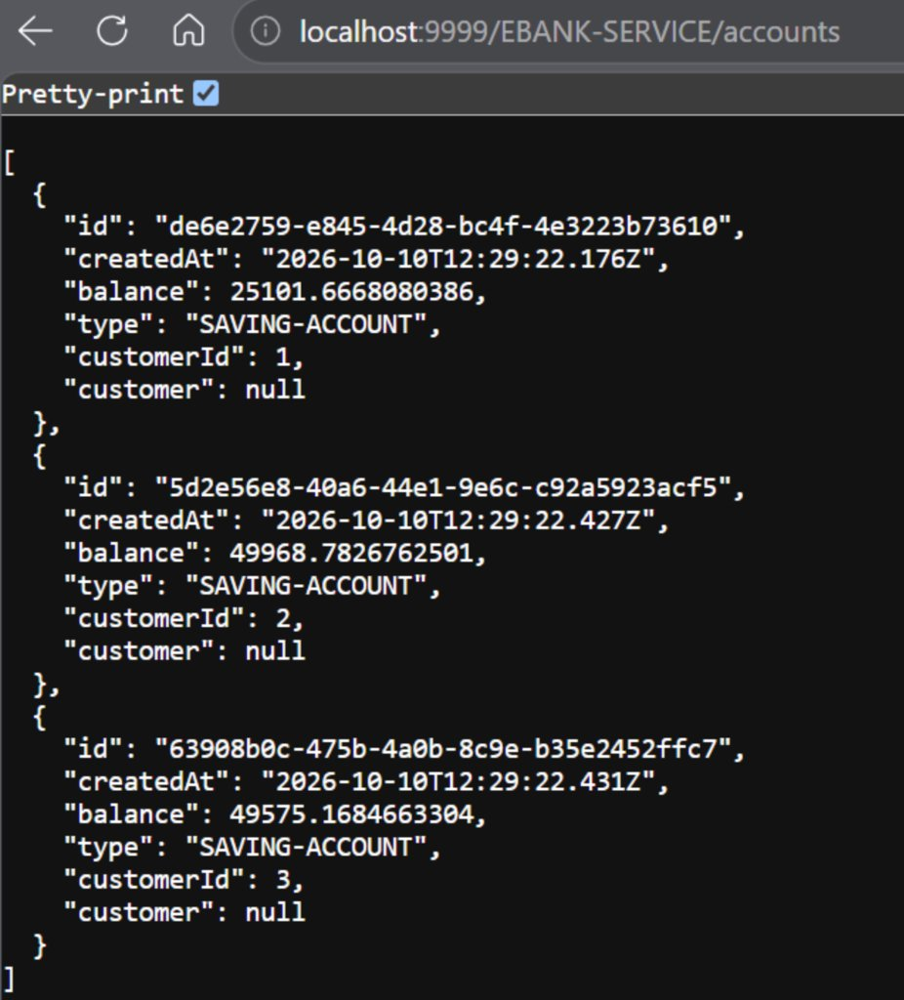
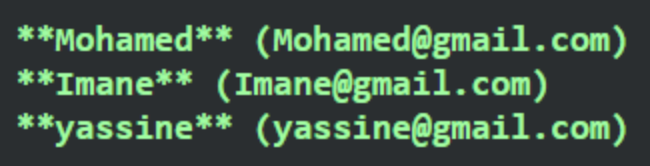

<div align="center">

# EBank — Architecture Microservices et Agent IA Bancaire

### Solution bancaire distribuee, reactive et pilotee par l'Intelligence Artificielle Generative via Spring Cloud, Spring AI et MCP (Model Context Protocol)

<br/>


<br/>

**Auteure : Imane Mekkaoui**  
Etudiante en Master Systemes Distribues & Intelligence Artificielle

</div>

---

## Sommaire

1. [Introduction et Contexte](#introduction-et-contexte)
2. [Architecture Globale du Systeme](#architecture-globale-du-systeme)
3. [Description Detaillee des Microservices](#description-detaillee-des-microservices)
   - [Discovery Service (Netflix Eureka)](#1-discovery-service--port-8761)
   - [Gateway Service (Spring Cloud Gateway WebFlux)](#2-gateway-service--port-9999)
   - [Customer Service](#3-customer-service--port-8056)
   - [EBank Service et MCP Server](#4-ebank-service--port-8057)
   - [EBank Bot et Agent IA Multi-Canal](#5-ebank-bot--port-8086)
   - [Frontend Client Angular 19](#6-frontend-client-angular-19--port-4200)
4. [Protocole MCP et Fonctionnement de l'Agent IA](#protocole-mcp-et-fonctionnement-de-lagent-ia)
5. [Galerie des Tests et Captures d'Ecran](#galerie-des-tests-et-captures-decran)
6. [Specifications de l'API REST](#specifications-de-lapi-rest)
7. [Pre-requis Techniques](#pre-requis-techniques)
8. [Guide d'Installation et Ordonnancement du Deploiement](#guide-dinstallation-et-ordonnancement-du-deploiement)
9. [Configuration des Environnements](#configuration-des-environnements)
10. [Structure du Projet](#structure-du-projet)
11. [Matrice des Technologies et Dependances](#matrice-des-technologies-et-dependances)

---

## Introduction et Contexte

Le projet **EBank** est une plateforme bancaire distribuee moderne concue pour repondre aux standards d'architecture d'entreprise : haute disponibilite, modularite, resilience, separation des responsabilites et interaction intelligente.

Au-dela des operations bancaires traditionnelles (gestion des clients et des comptes bancaires), la plateforme integre un **Agent Conversationnel IA autonome**. Construit avec le framework **Spring AI** et s'appuyant sur les modeles de fondation **Google Gemini**, cet agent est directement connecte aux microservices metiers par le standard emergent **MCP (Model Context Protocol)**. Il est accessible a travers plusieurs canaux simultanes :
- Une application Web SPA en **Angular 19** avec streaming reactif des reponses (Server-Sent Events / reactive streams).
- Un bot de messagerie mobile **Telegram**.
- Un bot communautaire **Discord**.

---

## Architecture Globale du Systeme

L'application repose sur un ensemble de microservices faiblement couples qui s'enregistrent aupres d'un annuaire Eureka et communiquent a travers une passerelle unifiee :

```
+---------------------------------------------------------------------------------------+
|                                    COUCHE CLIENTS                                     |
|    Navigateur Web (Angular 19)   |   Application Telegram   |   Client Discord        |
+-----------------+----------------+------------+-------------+------------+------------+
                  |                             |                          |
                  | HTTP REST / SSE             | Long Polling             | WebSocket  |
                  v                             v                          v
+-----------------------------------+   +-----------------------------------------------+
|          GATEWAY SERVICE          |   |                                               |
|       Port 9999 (Spring WebFlux)  |   |                                               |
|  - Routage dynamique Eureka       |   |                                               |
|  - CORS Filter Global             |   |                                               |
+-----------------+-----------------+   |                                               |
                  |                     |                   EBANK BOT                   |
                  | Routage dynamique   |              Agent IA Multi-Canal             |
                  v                     |                   Port 8086                   |
+-----------------------------------+   |  - Spring AI + Google Gemini                  |
|         DISCOVERY SERVICE         |<--+  - ChatClient avec Memoire Conversationnelle  |
|         Port 8761 (Eureka)        |   |  - MCP Client (Consommateur d'outils)         |
+---------+-------------------+-----+   |  - Endpoints REST (/chat, /chatStream)        |
          ^                   ^         +-----------------------+-----------------------+
          | Enregistrement    | Enregistrement                  |
          |                   |                                 | Appels d'outils MCP
          |                   |                                 | (Streamable HTTP / SSE)
+---------+---------+   +-----+-------------+                   |
| CUSTOMER SERVICE  |   |   EBANK SERVICE   |<------------------+
|     Port 8056     |   |     Port 8057     |
| - Referentiel JPA |   | - Comptes bancaires
| - Base H2 Memoire |   | - MCP Server (@McpTool)
| - API REST Client |   | - Client Feign (Resilience4j)
+---------^---------+   +-----+-------+-----+
          |                   |       |
          +--- OpenFeign -----+       +---> Base H2 Comptes
               + Circuit Breaker
```

---

## Description Detaillee des Microservices

### 1. Discovery Service — Port 8761

Le registre central de services assure la decouverte dynamique et l'aiguillage entre tous les microservices de l'ecosysteme sans couplage par adresses IP statiques.

- **Composant** : Netflix Eureka Server
- **Dependance** : `spring-cloud-starter-netflix-eureka-server`
- **Comportement** : Mode serveur autonome (`register-with-eureka: false`, `fetch-registry: false`).
- **Dashboard Eureka** : `http://localhost:8761`

---

### 2. Gateway Service — Port 9999

Point d'entree unifie du systeme base sur une architecture non-bloquante reactive.

- **Composant** : Spring Cloud Gateway Server (WebFlux)
- **Routage Dynamique** : Utilisation de `DiscoveryClientRouteDefinitionLocator` couple a Eureka pour publier automatiquement des routes d'acces du type `http://localhost:9999/{NOM-DU-SERVICE}/**`.
- **Politique CORS** : Configuration globale autorisant toutes les origines, methodes et en-tetes pour alimenter l'application Angular sans blocage Cross-Origin.

---

### 3. Customer Service — Port 8056

Microservice dedie au cycle de vie des clients bancaires.

- **Composant** : Spring Boot Web MVC + Spring Data JPA
- **Stockage** : Base relationnelle H2 en memoire (`jdbc:h2:mem:customer-db`)
- **Modele Metier** : Entite `Customer` (identifiant, nom, prenom, adresse email).
- **Contrat d'API** :
  - `GET /customers` : Liste exhaustive des clients.
  - `GET /customers/{id}` : Consultation d'un client par son identifiant unique.
  - `POST /customers` : Creation d'un nouveau client.

---

### 4. EBank Service — Port 8057

Microservice coeur metier charge des comptes bancaires, de la communication inter-services et de l'exposition des outils pour l'IA.

- **Composant** : Spring Boot Web MVC + Spring Data JPA + Spring AI MCP Server
- **Stockage** : Base relationnelle H2 en memoire (`jdbc:h2:mem:accounts-db`)
- **Console d'administration H2** : `http://localhost:8057/h2-console`
- **Documentation OpenAPI / Swagger** : `http://localhost:8057/swagger-ui.html`
- **Communication Inter-Services** :
  - Client declaratif **Spring Cloud OpenFeign** (`CustomerRestClient`) interrogeant le service `CUSTOMER-SERVICE`.
  - Mecanisme de tolerance aux pannes **Resilience4j Circuit Breaker** pour pallier l'indisponibilite eventuelle du service client.
- **Serveur MCP (Model Context Protocol)** :
  - Protocole : `streamable` (Server-Sent Events / HTTP).
  - Methodes decorees avec `@McpTool` et parametrees avec `@McpToolParam`.

```java
@McpTool(description = "Get all bank accounts")
public List<BankAccount> getAllBankAccounts() { ... }

@McpTool(description = "Get bank account by id")
public BankAccount getBankAccountById(@McpToolParam(description = "bank account id") String id) { ... }

@McpTool(description = "save new bank account")
public BankAccount save(@McpToolParam(description = "bank account to save(balance,type,customerId)") BankAccount bankAccount) { ... }
```

---

### 5. EBank Bot — Port 8086

Agent autonome base sur les LLM (Google Gemini) capable d'interpreter des intentions en langage naturel et d'executer des appels d'outils (Tool Calling) a travers le reseau.

- **Moteur IA** : Spring AI 2.0.1 avec le modele Google Generative AI (Gemini).
- **Gestion de Contexte** : `MessageChatMemoryAdvisor` conservant un fil de memoire par session ou par utilisateur.
- **Client MCP** : Connexion declaree vers l'URL SSE de `ebank-service` (`http://localhost:8057`). Les outils declares sur le microservice bancaire sont automatiquement injectes dans le `ChatClient` via `ToolCallbackProvider`.
- **Canaux d'Interaction** :
  - **REST API Synchrone** : `GET /chat?query=...&conversationId=...`
  - **REST API Asynchrone Reactive** : `GET /chatStream?query=...&conversationId=...` retournant un flux `Flux<String>`.
  - **Telegram Bot** : Client `TelegramLongPollingBot` reagissant aux messages textes entrants, affichant un indicateur de saisie ("typing..."), appelant l'agent avec un identifiant de conversation dedie (`telegram-{chatId}`) et restituant la reponse.
  - **Discord Bot** : Listener d'evenements JDA via `@DiscordController` et `@DiscordMapping`, gerant un fil memoire `discord-user-{id}-channel-{id}`.

---

### 6. Frontend Client Angular 19 — Port 4200

Application monopage moderne developpee en Angular 19 (composants autonomes Standalone, RxJS et directives structurelles avancees).

- **Composant Clients** (`ClientsComponent`) : Affichage des clients sous forme de tableau reactif via `AsyncPipe` et gestion des etats de chargement / erreur.
- **Composant Comptes** (`AccountsComponent`) : Consultation des comptes bancaires, type de compte (Courant / Epargne), solde et proprietaire.
- **Composant Assistant IA** (`BotUiComponent`) : Interface conversationnelle supportant les requetes instantanees et le streaming progressif de texte avec rendu Markdown dynamique via `ngx-markdown`.

---

## Protocole MCP et Fonctionnement de l'Agent IA

Le **Model Context Protocol (MCP)** standardise la maniere dont les modeles d'IA decouvrent et invoquent des fonctionnalites applicatives :

```
[Utilisateur]
      |  1. "Donne-moi la liste des clients" ou "liste des comptes"
      v
[EBank Bot : ChatClient Spring AI]
      |  2. Envoi du prompt systeme, de l'historique et des schemas MCP a Gemini
      v
[Google Gemini]
      |  3. Detection du besoin d'outil : appel de getAllCustomers() ou getAllBankAccounts()
      v
[EBank Bot : MCP Client]
      |  4. Requete RPC HTTP/SSE vers EBank Service
      v
[EBank Service : MCP Server]
      |  5. Execution de BankAccountRepository.findAll() ou Feign Client
      v
[Base de donnees H2]
      |  6. Donnees metiers (Clients: Mohamed, Imane, yassine / Comptes)
      v
[EBank Service --> EBank Bot]
      |  7. Retour JSON structure
      v
[Google Gemini]
      |  8. Synthese finale en langage naturel
      v
[Utilisateur (Web Angular / Telegram / Discord)]
         "Voici la liste des clients :
          1. ID : 1, Nom : Mohamed, Email : Mohamed@gmail.com
          2. ID : 2, Nom : Imane, Email : Imane@gmail.com
          3. ID : 3, Nom : yassine, Email : yassine@gmail.com"
```

---

## Galerie des Tests et Captures d'Ecran

Les captures ci-dessous illustrent l'integration reussie et le bon fonctionnement de l'ensemble des modules du systeme avec les donnees reelles de test (clients : Mohamed, Imane Mekkaoui, yassine).

### 1. Annuaire de Services Eureka (Service Discovery)

Enregistrement dynamique et verification de l'etat operationnel (Status UP) de tous les microservices (`CUSTOMER-SERVICE`, `EBANK-SERVICE`, `GATEWAY-SERVICE`, `EBANK-BOT`) sur le serveur Eureka.



---

### 2. Documentation et Test des Endpoints Swagger OpenAPI

Documentation OpenAPI 3.0 auto-generee pour `ebank-service`, permettant de tester interactivement la manipulation des comptes et l'exposition REST.



---

### 3. Application Web Angular — Repertoire des Clients

Affichage dynamique de la liste des clients charges depuis le microservice client a travers la passerelle Spring Cloud Gateway avec la session administrateur active d'**Imane Mekkaoui** et les clients du referentiel : Mohamed, Imane Mekkaoui, yassine.



---

### 4. Application Web Angular — Repertoire des Comptes Bancaires

Tableau des comptes bancaires affichant les identifiants UUID, soldes reels (25 101,67 EUR, 49 968,78 EUR, 49 575,17 EUR), types de comptes et clients associes sous la session admin d'**Imane Mekkaoui**.



---

### 5. Application Web Angular — Assistant Conversationnel IA

Interface de dialogue avec l'agent IA integre dans le frontend Angular. L'agent repond a la requete "Liste des clients" en extrayant les informations en direct via les outils MCP : Client 1 (Mohamed), Client 2 (Imane Mekkaoui), Client 3 (yassine).



---

### 6. Integration Mobile — Bot Telegram EBank (@EbankBotarm)

Execution en situation reelle du bot Telegram officiel `@EbankBotarm`. A la commande "liste des comptes", l'agent IA invoque les outils MCP de `ebank-service` et formate les comptes avec leurs identifiants UUID, types (`CURRENT-ACCOUNT`, `SAVING-ACCOUNT`), soldes et dates de creation.



---

### 7. Passerelle Spring Cloud Gateway — Endpoint API Comptes Bancaires

Consommation de l'API bancaire a travers la passerelle Spring Cloud Gateway sur le port 9999 (`http://localhost:9999/EBANK-SERVICE/accounts`) montrant le routage dynamique et la reponse JSON.



---

### 8. Reponse Structuree de l'Agent IA — Extraction des Clients

Formatage synthetique par l'Agent IA de la liste des clients retournee par l'appel d'outil MCP (`Mohamed`, `Imane`, `yassine`).



---

## Specifications de l'API REST

### Requetes directes ou via la Passerelle Gateway (Port 9999)

#### 1. Repertoire Clients

```http
GET http://localhost:9999/CUSTOMER-SERVICE/customers
Accept: application/json
```

Reponse :

```json
[
  {
    "id": 1,
    "name": "Mohamed",
    "email": "Mohamed@gmail.com"
  },
  {
    "id": 2,
    "name": "Imane",
    "email": "Imane@gmail.com"
  },
  {
    "id": 3,
    "name": "yassine",
    "email": "yassine@gmail.com"
  }
]
```

#### 2. Repertoire Comptes Bancaires

```http
GET http://localhost:9999/EBANK-SERVICE/accounts
Accept: application/json
```

Reponse :

```json
[
  {
    "id": "de6e2759-e845-4d28-bc4f-4e3223b73610",
    "createdAt": "2026-10-10T12:29:22.176Z",
    "balance": 25101.67,
    "type": "SAVING-ACCOUNT",
    "customerId": 1,
    "customer": null
  },
  {
    "id": "5d2e56e8-40a6-44e1-9e6c-c92a5923acf5",
    "createdAt": "2026-10-10T12:29:22.427Z",
    "balance": 49968.78,
    "type": "SAVING-ACCOUNT",
    "customerId": 2,
    "customer": null
  },
  {
    "id": "63908b0c-475b-4a0b-8c9e-b35e2452ffc7",
    "createdAt": "2026-10-10T12:29:22.431Z",
    "balance": 49575.17,
    "type": "SAVING-ACCOUNT",
    "customerId": 3,
    "customer": null
  }
]
```

#### 3. Agent IA Conversationnel

```http
GET http://localhost:9999/EBANK-BOT/chat?query=Donne-moi%20la%20liste%20des%20comptes&conversationId=session-01
Accept: text/plain
```

---

## Pre-requis Techniques

Avant de proceder au demarrage, verifiez que les elements suivants sont installes sur votre machine :

- **Java Development Kit (JDK)** : Version 21 ou superieure.
- **Apache Maven** : Version 3.9+ (ou utilisation des wrappers `mvnw` fournis dans chaque service).
- **Node.js** : Version 20.x ou superieure avec le gestionnaire de paquets **npm**.
- **Angular CLI** : Version 19+ (`npm install -g @angular/cli`).
- **Cle d'API Google Gemini** : Necessaire pour le microservice `ebank-bot` (Google AI Studio).
- **Identifiants de messagerie** (optionnels) :
  - Jeton Bot Telegram (delivre par `@BotFather`).
  - Jeton Bot Discord (delivre par le portail Discord Developer).

---

## Guide d'Installation et Ordonnancement du Deploiement

Pour garantir l'enregistrement ordonne des microservices et la resolution DNS locale par Eureka, respectez scrupuleusement la sequence de lancement ci-dessous.

### Etape 1 : Demarrage de l'annuaire de services (Eureka)

```bash
cd discovery-service
./mvnw clean spring-boot:run
```
*Le tableau de bord est accessible a l'adresse : http://localhost:8761*

### Etape 2 : Demarrage du microservice client

```bash
cd customer-service
./mvnw clean spring-boot:run
```
*Port d'ecoute : 8056*

### Etape 3 : Demarrage du microservice bancaire et serveur MCP

```bash
cd ebank-service
./mvnw clean spring-boot:run
```
*Port d'ecoute : 8057 | Swagger UI : http://localhost:8057/swagger-ui.html*

### Etape 4 : Demarrage de la passerelle Gateway

```bash
cd gateway-service
./mvnw clean spring-boot:run
```
*Port d'ecoute : 9999*

### Etape 5 : Demarrage de l'agent IA EBank Bot

```bash
cd ebank-bot
./mvnw clean spring-boot:run
```
*Port d'ecoute : 8086*

### Etape 6 : Demarrage du frontend Angular

```bash
cd angular-front
npm install
ng serve --port 4200
```
*L'application web est accessible sur : http://localhost:4200*

---

## Configuration des Environnements

Le microservice `ebank-bot` necessite le parametrage de la cle Gemini dans `ebank-bot/src/main/resources/application.properties` ou par variables d'environnement systeme :

```properties
# Port et identification du service
spring.application.name=ebank-bot
server.port=8086

# Configuration du modele LLM Google Gemini
spring.ai.google.genai.api-key=${GEMINI_API_KEY:VOTRE_CLE_API_GEMINI}

# Configuration du client MCP vers ebank-service
spring.ai.mcp.client.sse.connections.ebank-service.url=http://localhost:8057

# Parametres Telegram Bot (optionnel)
telegram.token=${TELEGRAM_BOT_TOKEN:VOTRE_TOKEN_TELEGRAM}
telegram.username=${TELEGRAM_BOT_USERNAME:EBankAssistantBot}

# Parametres Discord Bot (optionnel)
discord.token=${DISCORD_BOT_TOKEN:VOTRE_TOKEN_DISCORD}

# Enregistrement Eureka
eureka.client.service-url.defaultZone=http://localhost:8761/eureka/
```

### Table de Correspondance des Ports

| Composant | Port Reseau | Role et Protocole |
|---|---|---|
| **Discovery Service** | 8761 | Eureka Server HTTP / Tableau de bord |
| **Gateway Service** | 9999 | Point d'entree HTTP WebFlux / Reverse Proxy |
| **Customer Service** | 8056 | Service REST JPA Clients |
| **EBank Service** | 8057 | Service REST JPA Comptes + MCP Server SSE |
| **EBank Bot** | 8086 | Agent IA (Spring AI, Gemini, Telegram, Discord) |
| **Angular Front** | 4200 | Application Web Monopage (SPA) |

---

## Structure du Projet

```
ebank-ms-app-agent-Project/
|
|-- discovery-service/
|   |-- src/main/java/org/mekkaoui/imane/discoveryservice/
|   `-- src/main/resources/application.properties
|
|-- gateway-service/
|   |-- src/main/java/org/mekkaoui/imane/gatewayservice/
|   `-- src/main/resources/application.properties
|
|-- customer-service/
|   |-- src/main/java/org/mekkaoui/imane/customerservice/
|   |   |-- controllers/       (CustomerRestController)
|   |   |-- entities/          (Customer)
|   |   |-- repository/        (CustomerRepository)
|   |   `-- service/           (CustomerService)
|   `-- src/main/resources/application.properties
|
|-- ebank-service/
|   |-- src/main/java/org/mekkaoui/imane/ebankservice/
|   |   |-- controllers/       (EbankRestController)
|   |   |-- entities/          (BankAccount)
|   |   |-- feign/             (CustomerRestClient + Fallback)
|   |   |-- model/             (DTO Customer)
|   |   |-- repository/        (BankAccountRepository)
|   |   `-- services/          (EbankService decore avec @McpTool)
|   `-- src/main/resources/application.properties
|
|-- ebank-bot/
|   |-- src/main/java/org/mekkaoui/imane/ebankbot/
|   |   |-- agents/            (EbankAIAgent avec ChatClient et MCP Tools)
|   |   |-- controllers/       (EbankChatBotController synchrone et reactif)
|   |   |-- discord/           (DiscordBot avec annotations DiscordMapping)
|   |   `-- telegram/          (TelegramBot sous TelegramLongPollingBot)
|   `-- src/main/resources/application.properties
|
|-- angular-front/
|   |-- src/app/
|   |   |-- accounts/          (Consultation et gestion des comptes)
|   |   |-- clients/           (Consultation et gestion des clients)
|   |   |-- bot-ui/            (Chatbot conversationnel temps reel)
|   |   |-- services/          (Services d'etat et intercepteurs HTTP)
|   |   `-- model/             (Modeles TypeScript)
|   `-- angular.json
|
`-- screenshots/
    |-- eureka-dashboard.jpg
    |-- swagger-ebank.jpg
    |-- angular-clients.jpg
    |-- angular-accounts.jpg
    |-- angular-bot.png
    |-- telegram-bot.jpg
    |-- gateway-api-accounts.jpg
    `-- bot-client-response.png
```

---

## Matrice des Technologies et Dependances

| Domaine | Technologie retenue | Version | Role architectural |
|---|---|---|---|
| **Langage Backend** | Java OpenJDK | 21 | Executable source performant et moderne |
| **Framework Base** | Spring Boot | 4.1.1 | Socle applicatif et conteneur d'injection |
| **Framework Cloud** | Spring Cloud | 2025.1.3 | Orchestration et composants distribues |
| **Service Registry** | Netflix Eureka | Integre Spring Cloud | Annuaire de nommage et decouverte |
| **Passerelle API** | Spring Cloud Gateway | Integre WebFlux | Routage non-bloquant et filtrage |
| **Intelligence Artificielle** | Spring AI | 2.0.1 | Abstraction LLM et Tool Calling |
| **Modele Generatif** | Google Gemini | Google GenAI API | Comprehension et synthese en langage naturel |
| **Protocole Outils IA** | Spring AI MCP Server / Client | 2.0.1 | Standardisation des outils conversationnels |
| **Clients Declaratifs** | Spring Cloud OpenFeign | Integre | Appels HTTP inter-services transparents |
| **Tolerance aux Pannes** | Resilience4j Circuit Breaker | Integre | Isolation des pannes en cascade |
| **Persistance des Donnees** | Spring Data JPA / Hibernate | Integre | Mapping objet-relationnel |
| **Base de Donnees Embarquee** | H2 Database Engine | Runtime | Stockage volatil en memoire |
| **Documentation API** | SpringDoc OpenAPI UI | 3.1.0 | Specification Swagger et tests interactifs |
| **Client Telegram** | TelegramBots Spring Boot Starter | 6.9.7.1 | Interface conversationnelle Telegram |
| **Client Discord** | Spring Boot Starter Discord (JDA) | 4.0.1 | Interface conversationnelle Discord |
| **Frontend Framework** | Angular | 19.x | Application client Single Page (SPA) |
| **Programmation Reactive** | RxJS / Project Reactor | Integre | Flux asynchrones d'evenements et streaming |

---

<div align="center">

**Projet realise par Imane Mekkaoui**  
Master Systemes Distribues & Intelligence Artificielle — Session 2026

</div>
